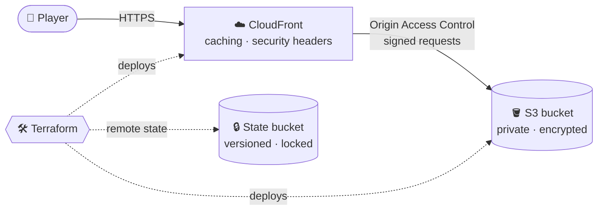
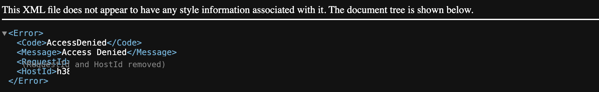
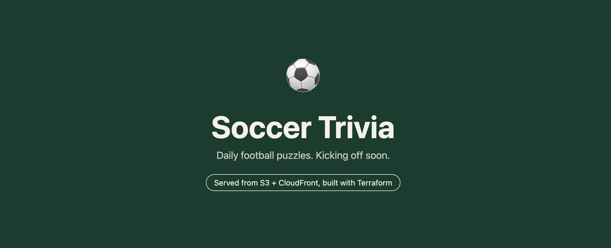

<div align="center">

# ⚽ Soccer Trivia

**Daily soccer puzzles on a secure, serverless AWS backend, built entirely with Terraform.**

[**🔗 Live site**](https://d28wxscj4itepe.cloudfront.net) · [Architecture](#-architecture) · [Security](#-security) · [Roadmap](#-roadmap)


</div>

---

## 📖 About

A daily soccer game site (guess the mystery player, name the career path, and more) where every puzzle resets at midnight and answers are checked on the server.

The project is built to show production-style cloud engineering: **infrastructure as code, least-privilege security, CI/CD with security scanning, and load testing**, while costing about **$0 a month** to run.

> 🚧 **In progress.** Secure hosting is live; the game backend comes next. See the [roadmap](#-roadmap).

---

## 🏗 Architecture



| Component | Role |
|---|---|
| **Amazon S3** | Stores the site files. Fully private: public access blocked, encrypted at rest |
| **Amazon CloudFront** | Serves the site over HTTPS worldwide, caches content, adds security headers |
| **Origin Access Control** | Lets only this CloudFront distribution read the bucket |
| **Terraform** | Defines every resource as code; remote state in a versioned, encrypted bucket with native S3 locking |

---

## 🔐 Security

- **Private bucket:** S3 Block Public Access on; the bucket policy allows reads only from this distribution
- **HTTPS only:** HTTP is redirected to HTTPS
- **Security headers:** HSTS, X-Frame-Options and X-Content-Type-Options (AWS managed policy)
- **Encryption at rest:** site bucket and Terraform state bucket
- **Account safety:** MFA, no root account use, budget alert

**Proof:** direct S3 access is blocked; the CloudFront URL works.

| ❌ Direct S3 access | ✅ Through CloudFront |
|:---:|:---:|
|  |  |

---

## 🗺 Roadmap

- [x] **Phase 1:** Private S3 + CloudFront hosting with Terraform
- [ ] **Phase 2:** Player database (Wikidata → DynamoDB) and Lambda + API Gateway backend
- [ ] **Phase 3:** Mystery Player game, with guesses checked server-side
- [ ] **Phase 4:** CI/CD with GitHub Actions: OIDC, CodeQL, Checkov, gitleaks, Terraform plan on pull requests
- [ ] **Phase 5:** Career Path game, levels, XP and leaderboards
- [ ] **Phase 6:** WAF, CloudWatch monitoring, and k6 load testing
- [ ] **Phase 7:** "The Gaffer," an AI hint assistant on Amazon Bedrock with prompt-injection tests
- [ ] **Phase 8:** Launch 🚀

---

## 🚀 Deploy it yourself

<details>
<summary><b>Show steps</b></summary>

**Prerequisites:** an AWS account, the AWS CLI, Terraform 1.10 or newer.

```bash
# 1. One time: create the Terraform state bucket
cd infra/bootstrap
terraform init
terraform apply

# 2. Deploy the website
cd ../site
cp backend.hcl.example backend.hcl   # add the state bucket name from step 1
terraform init -backend-config=backend.hcl
terraform apply
```

**Tear down:** run `terraform destroy` in `infra/site`. The state bucket is protected from deletion on purpose.

</details>

### Project structure

```
infra/
├── bootstrap/   # Terraform state bucket (run once)
└── site/        # S3 + CloudFront website
site/
└── index.html   # The website
docs/            # Screenshots for this README
```

---

## 💰 Cost

| Resource | Monthly cost |
|---|---|
| S3 + CloudFront (current traffic) | ~$0 |
| Terraform state bucket | ~$0 |

---

## 📚 What I learned

<!-- Write these in your own words. Interviewers read this section. -->
- Why a private bucket with Origin Access Control is safer than S3's built-in website hosting
- How Terraform remote state, versioning and locking prevent lost or conflicting changes
- How CloudFront managed policies add caching and security headers without custom code

---

<div align="center">
<sub>Independent fan project · not affiliated with any league or club · built by <a href="https://github.com/HananiahC">@HananiahC</a></sub>
</div>
